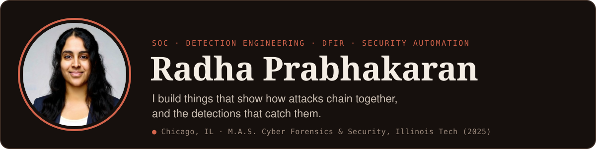
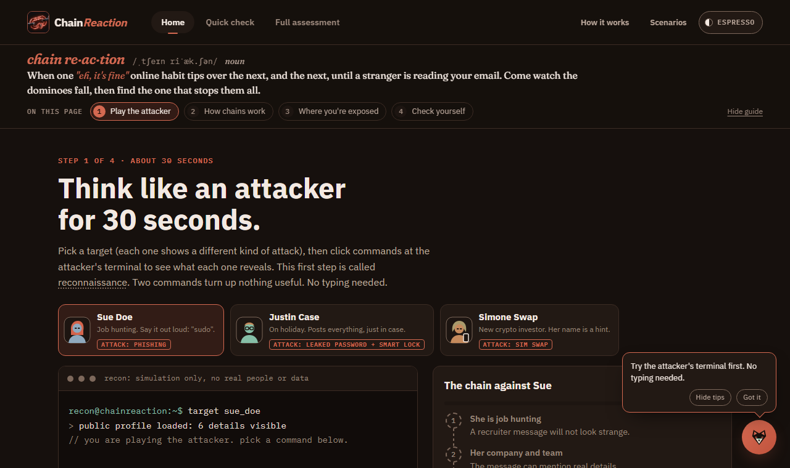

  

  
  &nbsp;
  

## About me

- Cybersecurity Automation Consultant at Gulf Coast Automation Group: asset inventory, vulnerability assessments and compliance reporting across Google Workspace and custom APIs.
- Trained in a SOC analyst cohort at Raíces Cyber, where I triaged 2,000+ simulated alerts in an instructor-built Elastic SIEM environment and tuned detection rules.
- IEEE-published researcher and patent co-inventor, with a B.E. in Electronics & Communication Engineering.
- Currently studying for CompTIA Security+ and building blue-team projects in the open.

## Featured projects

### [Chain Reaction](https://github.com/Radha1008/chainreaction-ewgh-2026)

A privacy-first attack-path simulator. Pick everyday habits and it draws the path an attacker could walk from one to the next, then shows the cheapest link to break. Runs entirely in the browser on a deterministic rules engine, with no tracking and no model calls.

- **Analyst mode** maps every step of every path to MITRE ATT&CK v20, with a Defender view of where each step could be detected, and says so honestly when no technique fits.
- **Detection Pack:** Sigma rules for the steps that leave a trace in Microsoft Entra ID and Exchange Online logs, tested on every push against attack and near-miss samples. CI validates each rule, checks fields against Sentinel table schemas, and builds KQL and SPL.

[**Live demo**](https://radha1008.github.io/chainreaction-ewgh-2026/) · [Detection Pack](https://github.com/Radha1008/chainreaction-ewgh-2026/tree/main/detections)

`JavaScript` `Sigma` `pySigma` `MITRE ATT&CK` `KQL` `SPL` `GitHub Actions`

### [Healthcare Management Database](https://github.com/Radha1008/healthcare-db-iit)

A secure MySQL healthcare database built for a Database Security course. AES-256 encryption at rest, TLS in transit, bcrypt-hashed passwords and role-based access control, with NIST SP 800-53 controls AC-2, AC-7 and AU-8 implemented and HIPAA-aligned access rules.

`MySQL` `Python` `NIST SP 800-53` `HIPAA`

### [Custom OSINT Phishing Detector](https://github.com/Radha1008/custom-osint-application-iit)

A Python GUI app that pulls data from multiple OSINT APIs to flag phishing indicators, delivered with a full project plan, risk management plan and earned value analysis.

`Python` `OSINT` `APIs`

### [University Cybersecurity Program Audit](https://github.com/Radha1008/cybersecurity-audit-iit)

A group audit of university security documentation against NIST SP 800-171A. We found gaps in malicious code protection, session management and configuration practices, and wrote remediation checklists for risk assessment, vulnerability monitoring and CUI handling.

`NIST SP 800-171A` `Audit` `Risk assessment`

## More work

| Project | What it covers |
|---------|----------------|
| [Source Code Analysis](https://github.com/Radha1008/source-code-analysis-iit) | Static analysis of an open-source project with Bandit, findings mapped to CWE |
| [SQL Injection & Data Mining](https://github.com/Radha1008/sql-injection-datamining-iit) | SQLmap exploitation, data extraction and analysis in RapidMiner/RStudio |
| [Active Cyber Defense Threat Model](https://github.com/Radha1008/active-cyber-defense-iit) | Threat model for a smart home, from physical break-ins to IoT attacks |
| [Linux Bash Scripting](https://github.com/Radha1008/linux-bash-scripting-iit) | Install automation, system status reporting and file cleanup scripts |
| [Securing the IoT Landscape](https://github.com/Radha1008/securing-iot-landscape-iit) | Research paper: Mirai, the Dyn DDoS and the Ring breach, with mitigations |
| [Multilevel Security](https://github.com/Radha1008/multilevel-security-iit) | Research paper: Bell-LaPadula, Biba, and MLS in practice |
| [Algorithmic Bias & Informed Consent](https://github.com/Radha1008/algorithmic-bias-informed-consent-iit) | Research paper on ethics and consent in social media platforms |

## Tech stack

**SIEM & detection** 

**Forensics & network** 

**Scripting & tools** 

**Frameworks** 

## Recognition & training

- **Winner**, Wireshark Workshop, IEEE WIE Global Tech Marathon (2025)
- **Competitor**, NCAE Cyber Games (2024 and 2025)
- **Publication:** [Wayside Inspection Using Wayside Processing Imaging and Deep Learning](https://doi.org/10.1109/ICPCSN58827.2023.00065), IEEE ICPCSN 2023. A U-Net (ResNet50) model that detects railway wheelset defects at 97.52% mPA.
- **Training:** ISO/IEC 27001:2022 Lead Implementer course (ICDF Academy), API Security Training Cohort (CyberSafe APISecurity Academy), SOC Core Skills (Antisyphon Training), Cyber Defense Pro (TestOut), DoD Cybersecurity Assurance Series
- **In progress:** CompTIA Security+ (SY0-701)
